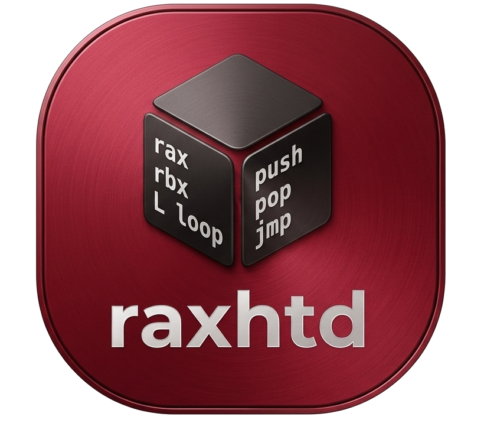
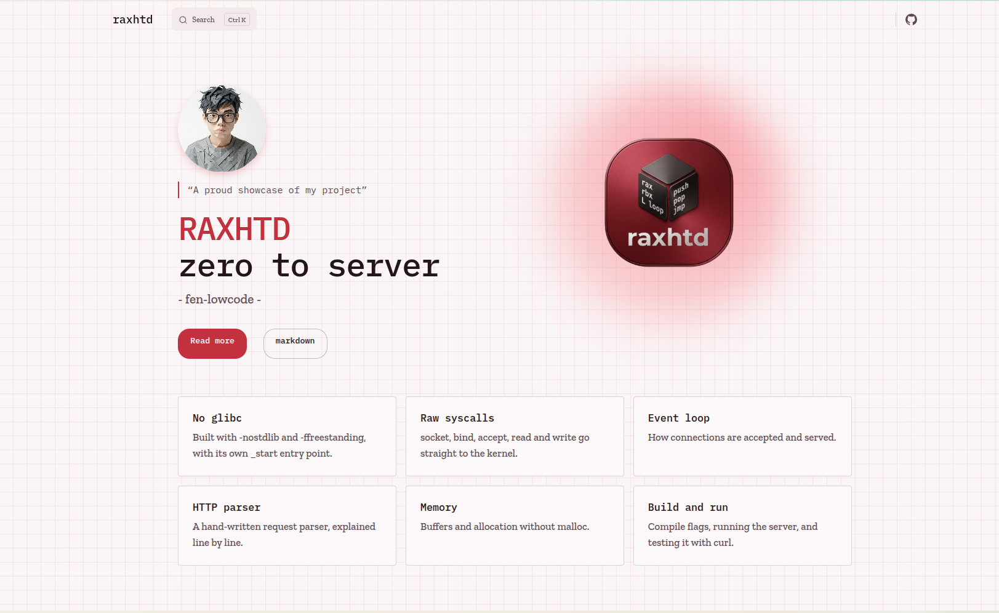

 </a>

<h3 align="center">raxhtd</h3>

Deeper understanding by going Zero

## Table of Contents

- [ What is RAXHTD ](#what)
- [ The purpose of RAXHTD ](#purpose)
- [ Writer's Manifesto ](#manifesto)
<!-- - [ Architecture ](#arch) -->
<!-- - [ How it works ](#templates)
- [ In-depth Technical analysis ](#art)
  - [Novice Technical Writers](https://www.writethedocs.org/guide/#new-to-caring-about-documentation)
  - [Experienced Technical Writers](https://www.writethedocs.org/guide/#experienced-documentarian)
  - [API Documentation](https://www.writethedocs.org/guide/#api-documentation)
  - [Adding badges](https://github.com/badges/shields/blob/master/README.md#examples)
  - [Tools](https://www.writethedocs.org/guide/#tools-of-the-trade)
- [Acknowledgements](#acknowledgements) -->

## What is RAXHTD 

**RAXHTD** (RAX HyperText Daemon) is an ultra-low-latency HTTP server written entirely from scratch in glibc-free C and x86_64 Assembly. Bypassing the standard C library entirely, RAXHTD eliminates the overhead of functions like printf() and malloc(). Instead, it interacts directly with the Linux kernel via raw system calls and relies on custom engineered, bare metal memory and string manipulation functions for maximum performance and a near-zero binary footprint.

## The Purpose 

Writing a server in this way serves as an excercise for me to get used in writing in 
C in an enviroment where there is no operating system to catch mistakes, which such is called **freestanding C**.

In this way i can advance my skills beyond normal software development and go beyond in the world of bare-metal IoT and Operating System development.

And indulging in a deeper understanding of how computer memory and networking works, how each layers of the linux operating system work together under the hood as close as possible to the linux kernel by building an HTTP web server without any abstraction on the way, is one of the best piece of art.

## To be clear
**RAXHTD** is not designed to replace production-grade enterprise servers like Apache or Nginx. Instead, it stands as a pure, educational pursuit a challenge to reclaim the mastery over the machine, stripping away the magic boxes to appreciate the raw engineering of the technology behind modern abstractions.

## Full Documentation 

 </a>

My project has become big and i wanted to keep track of everything in it and also to share what i learn with others, like you!. 

And ofcourse a simple README file won't fit all so i dedicated a documentation website all about my journey at creating raxhtd, come see it now! and learn by my side

Go here!: [https://fen-lowcode.github.io/raxhtd](https://fen-lowcode.github.io/raxhtd)

## My rules while developing raxhtd 

* Everything is from scratch excempt the gcc compiler 
* No use of AI-generated code, it is entirely written by hand, purely for education.
* Only allowed to write in C without standard glibc or third-party libraries and x64 Assembly
* I'm only able to use freestanding C headers, which are headers only defines structures, data types and macros such as: 

<!-- 

**Headers available as of C89**

  * <float.h>
  * <limits.h>
  * <iso646.h>
  * <stdarg.h>
  * <stddef.h>

**Headers available as of C99**

  * <stdbool.h>
  * <stdint.h>

**Headers available as of C11**

  * <stdalign.h>
  * <stdnoreturn.h>

**Headers available as of C23**

  * <stdckdint.h>
  * <stdbit.h> -->
